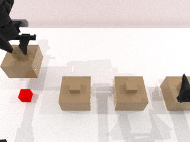
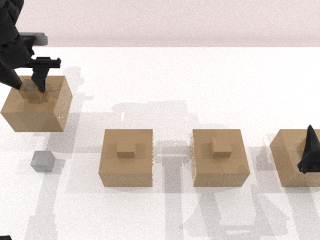

# M1 实施记录：可核验的重建回放与 K/D/R 分支诊断

更新：2026-10-14。远程项目根目录：`/home/user/workspace/HDD_8T/eventvla_recoverability_phase1_20261014`。

本轮完成了状态恢复的实测取舍、独立线索诊断任务、真实分支采集和存档检查。**没有训练评分器，没有完成三类正式任务，也没有获得新方法优于强基线的证据。** 当前代码和数据用于排除采集器错误，不能直接充当论文实验。

## 1. 状态恢复：拒绝原地快照，使用新进程重建

先在原始 `cover_blocks_hard` 上记录真实抓取、开盖、等待和放回的关节驱动轨迹。快照同时保存物理状态、场景位姿、驱动目标与速度、关节力、任务阶段/计数器、明确的控制器状态以及 Python/NumPy/PyTorch 随机数。分支续跑禁止调用规划器，避免未恢复的 cuRobo 搜索状态影响结果。

`PhysxCpuSystem.pack/unpack` 加 `Scene.pack_poses/unpack_poses` 在恢复瞬间误差约为 `1.19e-7`，但接触续跑发生明显分叉，两个种子的状态向量最大误差为 `1.9074` 和 `2.5010`，均超过事先设置的 `1e-3` 门槛。这是包含位置、旋转、速度等量的数值检查，不能解释成同一单位下的空间距离。该方法被拒绝用于配对标签；不能只因为初始位置接近就宣称恢复成功。

随后使用“**每个分支启动新进程 → 相同 seed 重建 → 回放相同驱动前缀 → 比较父状态与续跑**”。两个场景分别重复三次，共六次独立回放，结果如下。

| seed | 全轨迹物理步 | 前缀物理步 | 父状态最大误差 | 后续接触轨迹最大误差 | 父状态 RGB 最大误差 | RNG |
|---|---:|---:|---:|---:|---:|---|
| 100000 | 3293 | 1646 | 0 | 0 | 0 | 完全一致 |
| 100001 | 3273 | 1636 | 0 | 0 | 0 | 完全一致 |

运行目录：`runs/20261014T100630Z_rebuild_validation/`；报告：[重建验证](../reports/latest_rebuild_validation.json)。失败的原地快照记录保留在 `runs/20261014T100321Z_snapshot_validation/`，便于审计。

**适用范围严格限定为固定驱动回放。** 这没有证明完整 EventVLA 客户端缓存、策略服务器随机数或任意重新规划分支已经可以恢复。`snapshot.capture` 对其他控制模式直接报错，数据采集使用实际重建回放校验。

## 2. 独立诊断任务及观察权限

新增 `revisit_or_erase_cue_probe_v0`，继承现有物理场景，但独立定义检查和提交阶段，允许合法再次开盖。原始 `cover_blocks_hard` 的规则未改。

流程为：观察左侧盖子下的颜色 → 关盖 → 保留/删除记忆 → 执行公开的 preserve/erase 装置命令 → 查询原颜色 → 必要时实际再次开盖 → 提交答案。

当前的 erase 是把模拟颜色指示器清除为中性灰色的**显式高层装置命令**，不是 EventVLA 预测的 14 维机器人动作。开盖与回看由真实机械臂接触仿真执行，但关节轨迹由使用物体真值的专家提前编译。这一版本仅检验装置与采集链路，不能把它当作已完成非特权控制器或正式 T3。

四个位置的颜色独立、有放回采样，防止利用颜色排列排除法恢复被删答案。当前只查询一个公开指定位置，采用固定 ROI 的 RGB 读色器；读色器不接收 seed、任务对象、物体位姿、真值颜色、分支结果或文件路径。`public_observation` 仅输出 RGB 和本体状态的拷贝。

删除分支清空唯一持久证据图像，不保留颜色、embedding 或 KV 副本。该保证只适用于这里的小型诊断控制器；EventVLA 的 12 张时间锚点图像、事件库和近期缓存尚需单独审计。

## 3. 已执行的分支与结果

两个父场景 × 两个动作条件 × K/D/R 三个分支，另各重复一次 R，共 **16 次实际分支执行**，得到 **4 组诊断标签、2 个独立场景族**。重复 R 用于确认清除/保留之后的接触续跑稳定，不增加独立样本数。

所有配对的父物理状态、前缀轨迹、父 RGB、RNG、证据和控制器校验均通过；重复 R 的轨迹误差为 0。两个动作条件也共享同一干预前父状态。总采集时间约 326.85 秒，包括每个分支的新进程初始化。

| seed / 线索 | 条件 | K：保留 | D：删除、禁止回看 | R：删除、允许回看 | R 额外物理步 | 诊断删除代价 |
|---|---|---|---|---|---:|---:|
| 100000 / 红 | preserve | 正确 | 弃答 | 正确 | 3297 | 0.03297 |
| 100000 / 红 | erase | 正确 | 弃答 | 弃答 | 3297 | 1.03297 |
| 100001 / 绿 | preserve | 正确 | 弃答 | 正确 | 3295 | 0.03295 |
| 100001 / 绿 | erase | 正确 | 弃答 | 弃答 | 3295 | 1.03295 |

这里的“正确/弃答”是 RGB 诊断读色结果，不是 VLA 的任务成功率。物理步是 250 Hz 仿真 tick，不能与 `take_action_cnt` 或动作块数混用。

诊断成本暂用 `J = 失败 + 0.1 × min(物理步/10000, 1)`，删除代价为 `J(R)-J(K)`。记录续跑墙钟时间，但当前标签的时间权重为 0，避免冷启动与系统调度噪声进入标签；正式协议的尺度尚未冻结。

原始结果：[K/D/R 记录](../reports/latest_cue_branches.json)。真实图像如下，均未经过编辑。

回看可重新看到红色：



清除后，相同回看动作只能看到灰色：



## 4. 强基线检查与科学边界

在四个诊断条件上，完整历史图像读取和简短结构化记录均为 **4/4 正确**。每条未压缩 RGB 为 230,400 字节，PNG 约 125 KB；结构化颜色记录正文为 25～27 字节。这些只是载荷字节，不包括 Python 对象、索引、编码器或模型运行开销，不能据此宣传端到端加速比例。

这个结果符合预期：物理证据被清除，并不妨碍从旧图像或历史语义记录中恢复答案。更关键的是，本任务只有一个候选证据，任何正容量 FIFO 都装得下；D/R 是强制删除干预，并非 FIFO 自然淘汰失败。

因此，当前诊断**尚未通过 G1，也不具备证明学习淘汰有必要的条件**。所有输出均标记 `training_eligible=false`、`split=diagnostic`，不会混入 train/validation/test。尚未开始评分器训练。

## 5. 实际位置与运行方式

所有远程相对路径均位于本文开头的项目根目录。

| 内容 | 路径 |
|---|---|
| 共用仿真设置及观察白名单 | `src/recoverability/sim_runtime.py` |
| 原地快照诊断、驱动记录及回放 | `src/recoverability/snapshot.py` |
| 独立任务、RGB 读色与可删除记忆 | `src/recoverability/cue_probe_task.py`、`cue_reader.py` |
| 专家编译的固定轨迹与来源校验 | `runs/20261014T101607Z_cue_programs/` |
| 每个分支的 job、日志、图像、父状态及轨迹 | `runs/20261014T101642Z_cue_branches/` |
| 诊断 JSONL | `data/diagnostics/20261014T101642Z_cue_branches/pairs.jsonl` |
| 汇总与存档检查 | `reports/m1_validation.json`、`cue_archive_sanity.json` |
| 当前诊断协议 | `configs/cue_probe_protocol.json` |

使用前确认 GPU 1 空闲；未使用或终止 GPU 0 的已有作业。本次结束时 GPU 1 显存占用回到 17 MiB。

```bash
cd /home/user/workspace/HDD_8T/eventvla_recoverability_phase1_20261014

# 复查实际采用的重建回放方法；原地快照的失败是已记录的诊断结果。
CUDA_VISIBLE_DEVICES=1 CUDA_HOME=/usr/local/cuda-12.8 \
  envs/sim/bin/python scripts/validate_rebuild_replay.py \
  --source-run runs/20261014T100321Z_snapshot_validation

# 使用本次冻结的轨迹重新采集。源码或轨迹哈希发生变化会拒绝运行。
CUDA_VISIBLE_DEVICES=1 CUDA_HOME=/usr/local/cuda-12.8 \
  envs/sim/bin/python scripts/collect_cue_probe.py \
  --programs runs/20261014T101607Z_cue_programs/programs.json

# 重新编译轨迹：程序会输出新的 runs 路径，后续使用其中的 programs.json。
CUDA_VISIBLE_DEVICES=1 CUDA_HOME=/usr/local/cuda-12.8 \
  envs/sim/bin/python scripts/compile_cue_probe.py --seeds 100000 100001

PYTHONPATH="$PWD/src" envs/sim/bin/python -m pytest -q tests
```

39 项测试通过，新增覆盖 RGB 编码错误、颜色歧义弃答、删除后无残留语义、输入副本隔离、oracle 字段隔离、非有限状态拒绝及不支持的控制器快照拒绝。脚本编译检查通过。

## 6. 接下来的必要工作

1. 完成正式多证据任务：候选数量超过 4 条预算，加入可观察的恢复路径成本和真实动作引起的恢复机会变化；区分单候选删除标签与同预算淘汰。
2. 建立仅依赖合法观察的公共回看控制器，审计完整 EventVLA 的时间锚点、近期帧、动作块、服务端 RNG 和其他缓存；固定轨迹的恢复结果不能直接外推。
3. 扩大原任务验收和先导评测，先与动作知情规则、图像存档、结构化记录比较。若规则或紧凑存档已解决问题，应修改任务假设而非直接训练复杂模块。
4. 只有正式任务和控制器通过门槛后，采集分组训练数据并训练评分器。当前四条校准标签不进入训练。
