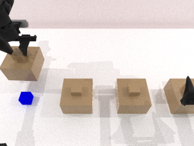
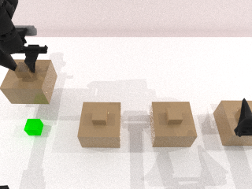

# 多证据容量压力与固定工位回看：实施及先导结果

更新：2026-10-14。项目根目录：`/home/user/workspace/HDD_8T/eventvla_recoverability_phase1_20261014`。

本轮实现了八条证据的自然容量竞争、测试时不读取物体真值的共享回看控制器、六种记忆对照及 2/4/8 条容量扫描。完成 30 个回合，63 项测试通过。**容量瓶颈已经出现，但动作知情规则没有超过“保留最早证据”；完整存档与结构化记录仍解决了全部查询。没有训练评分器，论文第一目标尚未达成。**

## 1. 任务与控制器

`multi_cue_versions_v1` 使用四个固定槽位、两轮独立颜色，共八个“槽位—版本”证据。第一轮观察并关盖后，公开装置命令将四个位置全部更新为第二轮颜色；第二轮再逐一观察。最后查询全部八个历史/当前值。颜色独立有放回采样，因此两个版本可能恰好同色，不可通过颜色排列排除法确定被删答案。

主容量为四张图像。FIFO 接纳后四条会自然淘汰前四条，没有人为删除它的指定证据。动作规则依据公开更新动作优先保留将不能从环境恢复的旧版本；缺失的当前版本可以实际再次开盖读取。

控制器只在独立 seed 424242 上接受一次专家校准，形成四个槽位的共享动作库。测试使用 seed 200000、200001、200002，相同动作文件用于所有方法和测试种子。测试阶段仅使用公开槽位指令、RGB、机器人关节状态和公开版本记录；专家抓取、物体位姿构造、oracle 关键帧与规划接口被设置为调用即报错。

这是**固定工位控制器**：关节驱动按照示范序列执行，RGB 检查线索可见性和关盖结果，起始关节状态超出校准范围则拒绝执行。没有视觉伺服或新布局泛化验证。完整输入契约见 [控制器说明](recovery_controller_contract.md)。离线专家示范的使用已明确记录，不把它说成无需示范。

## 2. 已执行的主容量结果

每种方法在三个独立颜色种子上运行，每回合八个查询。下表是 **颜色查询结果**，不是 EventVLA 操作任务成功率；同一回合的八个查询也不是八个独立场景样本。

| 方法 | 持久图像数/权限 | 正确查询 | 全部答对的回合 | 实际回看次数 |
|---|---|---:|---:|---:|
| FIFO | 最多 4 张 | 12/24 | 0/3 | 0 |
| 均匀抽样 | 最多 4 张 | 18/24 | 0/3 | 6 |
| 保留最早证据 | 最多 4 张 | 24/24 | 3/3 | 12 |
| 动作知情规则 | 最多 4 张 | 24/24 | 3/3 | 12 |
| 完整图像存档 | 无存储上限，本次 8 张 | 24/24 | 3/3 | 0 |
| 结构化记录 | 无存储上限，本次 8 个颜色记录 | 24/24 | 3/3 | 0 |

所有图像方法每次查询最多读取一张历史图像；结构化记录直接读取对应颜色。当前环境观察另计。所有方法使用相同回看触发条件、运动库和读色器。

未知且已覆盖的历史值统一弃答，计作错误，没有加入猜测基线。因此不能将这些比例直接外推为 VLA 面对不确定信息时的答题表现。回看后的图像是本次当前观察，用后释放；查询互不重复，查询阶段不再更新历史库。

## 3. 容量扫描

| 方法 | 2 条容量 | 4 条容量 | 8 条容量 |
|---|---:|---:|---:|
| FIFO | 12/24 | 12/24 | 24/24 |
| 动作知情规则 | 18/24 | 24/24 | 24/24 |

FIFO 在容量扩大到八条后消除了错误；在四条容量时，丢失的是已被第二轮覆盖的第一轮证据。配合下列控制与配对检查，当前结果支持“这些失败来自容量限制下的证据淘汰”，而不是抓取或颜色读取失败。

这些对比不能证明动作输入必需：在三个测试种子上，动作规则相对 FIFO 每回合多答对四个问题，但相对“保留最早证据”差值均为零。当前覆盖顺序与证据年龄完全相关，简单时间规则就足够。

## 4. 控制与配对证据

- 30 个实际回合，240 次初始线索观察，240 次查询决策。
- 初始颜色读取正确 240/240；实际回看正确 48/48。
- 所有方法在同一 seed 下的前缀物理状态、RGB 哈希、RNG 与动作库哈希完全一致。
- 运行时被禁用的专家几何/规划接口调用为 0；所有测试使用同一个校准动作库。
- 有界方法在每次更新后均满足容量；没有被删颜色的隐形语义档案。
- 全矩阵出现的 36 个错误均为缺失历史证据后的弃答，没有观测或回看读色错误。
- 总墙钟时间约 892.34 秒；结束时 GPU 1 回到 17 MiB。未使用或终止 GPU 0 的已有作业。

下面是 seed 200000、槽位 0 的真实图像。旧值为蓝色，后续再次打开同一盖子看到的是绿色，因此当前观察不能替代旧证据。另一些槽位的两轮颜色恰好相同，原始记录也完整保留。





## 5. 资源与强基线意味着什么

四张 320×240 RGB 的原始载荷为 921,600 字节，完整八张为 1,843,200 字节。结构化基线保留了可观察颜色，其 JSON 状态载荷在三个种子上最多 212 字节。载荷统计不包括 Python 容器、索引实现、模型/运行库或编码器开销。

所有方法共享的电机参数数组共 12,354,912 字节，与事件记忆分开计量。每个结果文件另外记录进程 RSS；进程 RSS 包含仿真及运行库，不能当成记忆模块占用。

动作规则在三个回合中多执行了 39,939 个物理 tick 的回看操作。物理 tick、模拟时间和墙钟时间不同；本控制器只在少数指定时刻渲染，没有 EventVLA 推理调用，不能用本次耗时推断完整 VLA 的速度。

在当前小型颜色任务上，完整图像存档不需要额外回看，结构化记录更便宜。精确“槽位—版本”索引也使检索很容易。这些是应接受的强对照，不能通过削弱其存储或查询权限制造新方法优势。

## 6. 代码、数据与复现

下列远程路径相对于本文开头的项目根目录。

| 内容 | 位置 |
|---|---|
| 多证据任务 | `src/recoverability/multi_cue_task.py` |
| 共享动作库加载、执行与真值接口拦截 | `src/recoverability/fixed_skills.py` |
| FIFO/均匀/最早保留/动作规则/存档/结构化记录 | `src/recoverability/versioned_memory.py` |
| 动作库及校准图像 | `runs/20261014T111504Z_shared_skill_library/` |
| 30 回合逐步图像、查询、存储审计与日志 | `runs/20261014T112024Z_multicue_eval/` |
| 先导逐回合索引 | `data/pilots/20261014T112024Z_multicue_eval/episodes.jsonl` |
| 完整结果与汇总 | `reports/latest_multicue_eval.json`、`reports/multicue_validation.json` |
| 运行协议 | `configs/multicue_protocol.json` |

```bash
cd /home/user/workspace/HDD_8T/eventvla_recoverability_phase1_20261014
nvidia-smi

# 复用本次共享动作库，重新运行三种子和 2/4/8 容量先导。
CUDA_VISIBLE_DEVICES=1 CUDA_HOME=/usr/local/cuda-12.8 \
  envs/sim/bin/python scripts/run_multicue_eval.py \
  --library runs/20261014T111504Z_shared_skill_library/library.json \
  --seeds 200000 200001 200002 --capacity-sweep

envs/sim/bin/python scripts/summarize_multicue_eval.py
PYTHONPATH="$PWD/src" envs/sim/bin/python -m pytest -q tests
```

63 项测试通过，涵盖零容量、版本匹配、图像副本隔离、无残留语义、自然 FIFO 淘汰、公开动作规则、完整存档权限、起始关节保护和运行时真值接口拒绝。所有先导输出标记 `training_eligible=false`；三个测试种子不应再用于后续训练。

## 7. 对研究方向的判断

本轮完成了用户指定的两项工程推进：多证据容量压力和固定工位下的运行时无真值回看。第一阶段研究目标仍未完成，三类正式任务也尚未全部实现。

继续做学习方法之前，需要让“证据年龄”与“未来可恢复性”不再重合，并验证实际拟执行机器人动作带来的变化；同时加入不易由颜色表格完整替代的视觉证据及有意义的任务需求。新增任务仍须让最强规则、结构化记录和完整存档公平竞争。如果它们继续廉价解决任务，就应收窄研究假设，而不是在当前数据上训练评分器并把拟合结果当作创新。

完整 EventVLA 适配、时间锚点/近期缓存删除审计、新布局控制、真实动作条件配对及正式训练仍是后续工作。当前提交是符号颜色回答，版本更新是公开装置命令；不能声称已经获得端到端 VLA 操作性能提升。
