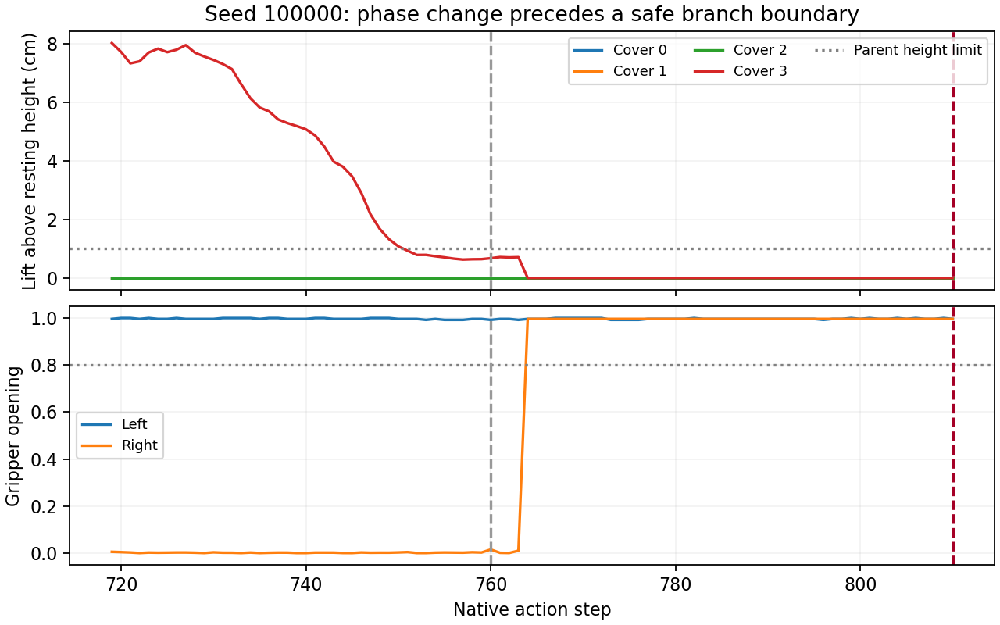

# 安全分支点、揭盖判据及不同目标对照结果

后续进展：本文提出的保留／删除／错配闭环已完成，见 [记忆依赖性对照结果](native_memory_results_20261015.md)。下文保留本轮边界校准的历史记录。

2026-10-15 已完成。**分支点与评价修正通过两个种子的原生正对照，原生续接 2/2 正确揭盖；各自重复轨迹完全一致。不同位置短指令的首次选择为 0/2，均仍抬起原生红块盖子。正式 K/R 标签尚未采集，正式评分器没有开始训练。**

运行位置：`/home/user/workspace/HDD_8T/eventvla_recoverability_phase1_20261014/runs/20261015T092610Z_native_boundary_controls`，实际挂载位置为 `/media/user/HDD_8T/eventvla_recoverability_phase1_20261014/runs/20261015T092610Z_native_boundary_controls`。
北京时间 17:26–18:01，单 GPU 1 串行。协议见 [native_boundary_protocol.md](native_boundary_protocol.md)。

## 修正内容

原任务在盖子离开 reveal 区域时即可切换到 final 阶段；此时盖子仍可能悬空。新分支点要求四个盖子落回、遮住对应块、双夹爪松开，且当前动作块自然执行完。按首次满足条件的边界保存，没有根据后续成败选择起点。

| 种子 | 旧父状态步数 | 新父状态步数 | 原生续接到新父状态 | 三视角彩色块可见像素 |
|---|---:|---:|---:|---|
| 100000 | 718 | 810 | 92 个动作、1 次模型请求 | 均为 0 |
| 100001 | 720 | 808 | 88 个动作、1 次模型请求 | 均为 0 |

新父状态四个盖子相对初始静置高度的误差均在微米量级，双夹爪开度约 0.996。原始 actor segmentation 与三视角图像检查一致：当前观察没有露出的彩色块。未修改物理场景、未调用专家动作，旧前缀重放的物理状态、图像和历史匹配检查全部通过。

揭盖不再相对可能已悬空的父状态归零：记录相对初始桌面静置位置的抬升（超过 4 cm、连续三个物理子步），并分别记录原任务的 reveal 位置判据及 final_pointer 变化。抬升不自动等同于揭盖完成。



## 闭环结果

槽位 0–3 从左到右。native_repeat 是重复性验证，不计为新增独立种子。

| 种子 | 条件 | 指令目标槽位 | 首次抬起槽位 | 指定目标实际揭开 | 动作数 |
|---|---|---:|---:|---|---:|
| 100000 | 原生整段指令 | 2 | 2 | 是 | 101 |
| 100000 | 原生重复 | 2 | 2 | 是 | 101 |
| 100000 | `Finally open the rightmost cover.` | 3 | 2 | 未执行到揭开；首次选择错误即停止 | 88 |
| 100001 | 原生整段指令 | 3 | 3 | 是 | 101 |
| 100001 | 原生重复 | 3 | 3 | 是 | 101 |
| 100001 | `Finally open the leftmost cover.` | 0 | 3 | 未执行到揭开；首次选择错误即停止 | 87 |

共 8 个完成记录：2 个父状态准备、6 个续接，策略阶段执行 759 个动作、18 次模型请求；固定前缀重放另计。两个原生正对照均由物理揭盖和原任务进度共同确认成功。不是完整任务成功率，也不是正式基准统计。

两组原生重复的动作哈希及最终物理状态哈希均完全一致。每组 native、native_repeat、position_other 的父状态、历史、第一请求图像载荷一致；新指令在自然边界处生效，没有清空未完成的动作块。
源码检查确认 EventVLA 推理从 `example['lang']` 构造模型提示词。不同目标分支的首个请求中已是新语言，且轨迹确有变化，但首次选中的仍是原生红块槽位。这支持“本轮短指令未可靠改变目标”，不能外推为模型普遍不理解语言。
错误抬盖后立即停止，不评价后续能否纠正；这两条失败也不能作为记忆删除损失。

## 模型输入与删除审计

两个父状态的首个实际模型请求都由 12 张时间锚点图像和 4 张事件图像组成。事件写入器已经将主视角图像缩放后存储；不能把四条事件误算成十二张事件图像。

- 在 CPU 上从可信客户端快照重建输入，与真实在线请求逐图像哈希匹配。
- 检查了首帧、前 30 步、前 15 步和当前三视角图像，未看到露出的颜色；四张事件图像保存了对应颜色证据。
- 每个种子分别做保留、逐条删除四条事件、删除全部事件，共 12 组离线输入检查。时间锚点不变，保留分支与原输入完全相同，被删事件的已知图像哈希无残留；动作及待提交事件缓存清空检查通过。
- 删除全部事件后，图像载荷从 2,408,448 字节降到 1,806,336 字节，保留 12 张时间锚点图像。

这些是输入构造检查，没有执行删除后的策略或恢复分支，不是 K/R 样本。哈希审计也不等于彻底消除可推断的信息：四种颜色构成已知排列时，剩余三条事件可能仍能推出被删颜色的位置。

## 对研究主线的影响

四步目标保持不变。本轮完成了第二步中的分支点与评价校准，提供两个通过原生正对照、当前视觉证据被遮挡且可精确复现的父状态。正式恢复性配对任务、恢复成本变化与学习淘汰优势仍未完成。

下一步先保持已验证有效的原生整段指令，对这些父状态做保留／移除全部事件／错配历史的闭环对照，检验动作选择是否确实依赖事件记忆。不能仅用“删掉目标那一帧”排除颜色排列推断这一捷径。
确认记忆依赖后，再接入重复颜色、多证据容量压力和动作改变恢复机会的任务，以及共享回看控制器，采集正式 K/R。若任务必须依赖自由位置短指令，需要另做执行器适配；不能把短指令执行失败混进记忆价值监督。

## 验证与资源

本地和 Pro5000 上各有 21 项相关测试通过，包括过早分支、盖子悬空、夹爪未松开、原高度漏判、瞬时与同时抬升，以及原快照/配对回归。最终配对汇总在服务器和本地均通过，12 组离线输入删除检查通过。

210 条资源样本：主机可用内存最低 205.21 GiB；CPU 最高 62°C；GPU 1 最高 83°C、显存最高 15,689 MiB；告警样本为 0。作业已完成并清理自己启动的进程。这只描述本轮运行，不代表此前硬件死机原因已经消除。

## 复现与文件

- `scripts/native_boundary_worker.py`：新父状态准备、原生/位置对照和评价。
- `src/recoverability/native_boundary.py`：纯数值父状态检查和绝对高度事件。
- `scripts/run_native_boundary_controls.py`：串行运行、资源监控与清理。
- `scripts/summarize_native_boundary.py`：完整记录、配对载荷与重复性验证。
- `scripts/audit_native_parent_inputs.py`：CPU 输入重建、图像拼图及离线删除审计。
- `reports/native_boundary_validation.json`：逐种子配对检查与结果。
- `reports/native_boundary_analysis.json`：计数、资源和删除检查汇总。
- 运行目录每个 `*_prepare/`：新 `parent.json`、完整动作前缀、协议 5 客户端快照、三视角图及 `input_audit/`。
- 运行目录各控制分支：`result.json`、动作数组和终态图；根目录含源码快照、监控记录与状态。

```bash
cd /home/user/workspace/HDD_8T/eventvla_recoverability_phase1_20261014
envs/tools/bin/python scripts/summarize_native_boundary.py runs/20261015T092610Z_native_boundary_controls/status.json
envs/sim/bin/python scripts/audit_native_parent_inputs.py runs/20261015T092610Z_native_boundary_controls/100000_prepare
```

以上两个命令根据现有实验重建输入或汇总结果，不启动新的 GPU 策略或仿真回合。不要重复启动已经完成的控制套件。
