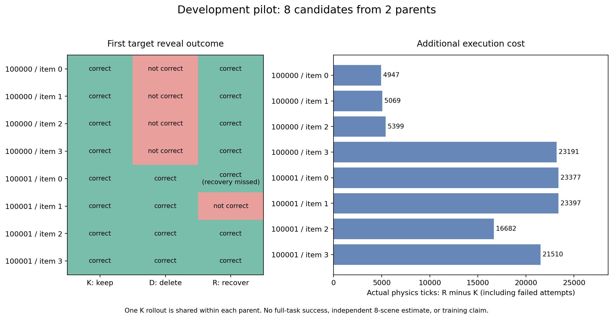

# 逐条先导续跑与样本扩展（2026-10-16）

更新时间：2026-10-16T15:48:14.198549+08:00。

## 已完成

服务器重启后确认旧进程已退出。原目录实际落盘 14 条完整分支，只在新目录补跑四条；原中断目录及其不完整尝试保留。恢复前核对了全部原运行源文件哈希，补跑期间未切换内容替换扩展版本。

18/18 条完整分支形成 8 组 K/D/R，来自两个开发父状态，全部通过 226 项配对和输入审计。K 每父状态只执行一次，不能把复用的 K 当作新增独立回合。

| 父 seed | 候选索引 | K | D | R | R 是否取回候选 | R−K 实际总物理 tick |
|---|---:|---|---|---|---|---:|
| 100000 | 0 | 正确 | 失败 | 正确 | 取回 | 4947 |
| 100000 | 1 | 正确 | 失败 | 正确 | 取回 | 5069 |
| 100000 | 2 | 正确 | 失败 | 正确 | 取回 | 5399 |
| 100000 | 3 | 正确 | 失败 | 正确 | 取回 | 23191 |
| 100001 | 0 | 正确 | 正确 | 正确 | 未取回 | 23377 |
| 100001 | 1 | 正确 | 正确 | 失败 | 取回 | 23397 |
| 100001 | 2 | 正确 | 正确 | 正确 | 取回 | 16682 |
| 100001 | 3 | 正确 | 正确 | 正确 | 取回 | 21510 |

“正确”仅指首次目标揭盖。第一场景四条分别删除均失败、单工位回看后均成功；第二场景四条分别删除均成功，回看有一条反而失败。第二场景候选 0 的恢复尝试三次未取回，但策略仍正确揭盖；恢复是否成功和任务是否成功分别记录。



## 内容与数量对照

固定四个事件位置、时间戳和其他元数据，分别把 seed 100000 的候选 0、2 换成当前实际拍到的闭盖无证据头部图像，另重跑 keep。其他物理状态、时序锚点和首个推理种子相同。它是反事实输入诊断，不是可部署记忆策略，也不产生训练标签。

三条内容对照完成，24 项审计通过。
- 替换候选 0：正确揭盖，101 动作。
- 替换候选 2：未正确揭盖，87 动作。

非目标内容置空仍成功、目标内容置空则失败；直接删除这两个事件却都失败。因此已观察到内容价值差异，也发现事件数量/序列变化的混杂。正式数据协议应采用一致的输入槽位与明确的空位表示后重新校准，不能直接训练当前删条标签。

## 新父状态

已完成 2 个预先指定新 seed 的尝试，取得 2 个合格父状态（严格状态指纹去重后 2 个），保留记忆续接正确揭盖 2 个；24 项审计通过。颜色排列共 2 种。固定工位只有 24 种颜色排列，不把 seed 数量直接当作独立场景数。

| seed | 合格父状态 | 首次揭盖 | 说明 |
|---|---|---|---|
| 410000 | 是 | 正确 | 回放及实际输入已审计 |
| 410001 | 是 | 正确 | 回放及实际输入已审计 |


正在运行批次 `20261016T074712Z_native_parent_collection`，PID `47818`，GPU `1`，预定 seed `[410002, 410003, 410004, 410005, 410006, 410007, 410008, 410009, 410010, 410011, 410012, 410013, 410014, 410015, 410016, 410017, 410018, 410019]`。当前落盘 0 条完成记录；采集、续接分别记一条，不代表同等数量父状态。此批次未完成验收，不计入上面的已验收数。

新入口从原生指令的真实 EventVLA rollout 获取闭盖、夹爪释放且动作块结束的父状态，并依次验证独立动作回放、保留记忆续接、实际首个模型请求和离线逐条删除。拒绝、失败和成功都留档，不按最终成功筛样本。20 个 seed 是先导名单，不是最终测试集；同一父状态的兄弟分支必须同组。

首次新父状态批次在完成 seed 410000 的采集和保留分支后，输入审计因使用缺少 OpenCV 的策略环境退出。已改用现成仿真环境完成 CPU 审计，并从新运行目录继承两条完成记录；旧失败状态和日志保留，不重复 GPU 推理，不把基础设施失败误计为任务失败。新运行记录修复原因、继承路径和源文件哈希差异。

## 研究边界与下一步

仍处于第二步的协议校准与样本扩展，逐条采集的工程链路已跑通，正式评分器训练尚未开始。原方案的三类正式任务、动作配对与未见场景验证尚未完成。

现有数据不足以支持学习方法超过强规则。R 使用强制尝试候选的固定策略，可能产生不必要的回看；推理随机数仍按 timestep 设置，正式采集须预先固定共同随机数协议。删除会改变事件数量，内容对照用于检查这一混杂因素，不能把当前开发标签直接升级为正式训练数据。

正式采集前固定评价终点、输入槽位/填充规则、随机数配对和恢复触发协议；然后用新的父场景分组进行批量先导及首版评分器试训。36 项相关单元测试已通过；新增父状态入口依赖实际回放和模型输入审计验收。

## 资产与复现

远程根目录：`/home/user/workspace/HDD_8T/eventvla_recoverability_phase1_20261014`。

- 原逐条运行：`runs/20261016T031445Z_native_recovery_item_pilot`。
- 续跑：`20261016T070153Z_native_recovery_item_pilot_resume`，继承 14 条，只新增 4 条。
- 完整开发数据：`data/native_item_development_pilot/labels.jsonl`、`manifest.json`。
- 审计：`reports/native_item_pilot_validation.json`；内容与新父状态审计分别保存在 `native_content_probe_validation.json`、`native_fresh_parent_validation.json`。
- 图：`reports/native_item_images/item_pilot.png`、`item_pilot.pdf`。
- 历史失联断点保留在 `docs/native_item_progress_20261016.md`，以本文和最新运行状态为当前进展。

```bash
cd /home/user/workspace/HDD_8T/eventvla_recoverability_phase1_20261014
envs/tools/bin/python scripts/analyze_native_items.py
envs/tools/bin/python scripts/analyze_content_probe.py
envs/tools/bin/python scripts/analyze_fresh_parents.py --reports runs/20261016T073957Z_native_parent_collection/status.json runs/20261016T074712Z_native_parent_collection/status.json
```

重新启动实验前先查看 latest 状态、进程和 GPU；不要重复跑已完成的旧先导。新父状态合并分析命令须等所有列出的批次完成后再执行，未完成时会主动报错。上述分析命令只读取已有结果并生成审计产物，不启动 GPU 实验。批次名单与后续入口保存在 `reports/native_parent_collection_plan.json`。
