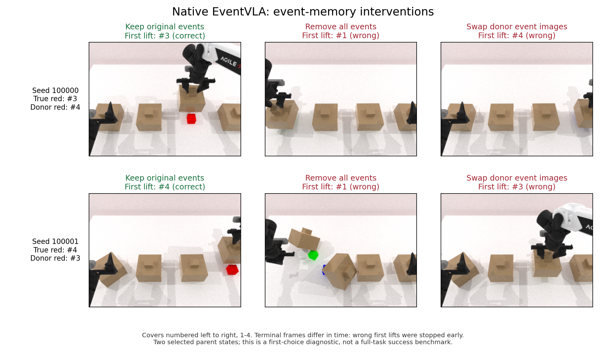

# 原生 EventVLA：保留、删除与错配事件记忆的闭环结果

2026-10-15 已完成六条有效轨迹。**保留事件首次选对目标 2/2；删除全部事件 0/2；错配事件 0/2，且两个错配分支均选中了供体记忆中的红色位置。** 这支持两个已选定原生父状态中的事件记忆依赖性，尚不能证明恢复性评分器优于规则或存档。

四步目标仍处第二步。本轮完成记忆依赖性诊断；正式 K/R 采集与正式 EventVLA 评分器训练尚未开始。早期机制先导的标签和评分器不与本轮混合。

## 条件与结果

沿用已验证的原生整段指令、同一物理父状态和时序锚点。seed 100000 在第 810 步分支，seed 100001 在第 808 步分支。每次模型请求均清服务器记忆并固定配对随机种子；三个条件均清客户端动作及待提交事件缓存。

错配将另一种子的四张历史检查图像按事件顺序换入，保留接收方的事件时间、置信度等元数据。供体选择和停止条件在运行前固定，见 [实验协议](native_memory_protocol.md)。本轮只是删除分支起点的历史事件，后续根据新画面产生的正常事件写入仍然开启。

以下盖子编号均为从左到右 **1–4**；原始 JSON 使用 0–3。

| 种子 | 条件 | 真实红块位置 | 首次抬盖 | 跟随供体红块位置 | 策略动作数 |
| --- | --- | --- | --- | --- | ---: |
| 100000 | 保留 | 3 | 3，随后正确揭盖 | 不适用 | 101 |
| 100000 | 全删除 | 3 | 1，错误 | 不适用 | 86 |
| 100000 | 错配 | 3 | 4，错误 | 是 | 86 |
| 100001 | 保留 | 4 | 4，随后正确揭盖 | 不适用 | 101 |
| 100001 | 全删除 | 4 | 1，错误；同一动作内还碰起盖子 2 | 不适用 | 75 |
| 100001 | 错配 | 4 | 3，错误 | 是 | 89 |

有效轨迹共 538 个干预后策略动作、14 次模型请求；前缀重放和未完成尝试另计。两个保留分支的完整动作哈希、最终物理哈希均与上一轮原生分支完全一致。



首次抬盖按相对初始静止高度超过 4 cm、持续三个物理 tick 计；停止发生在该策略动作完成后。第二个删除分支在 tick 6889 和 6891 分别触发盖子 1、2 的抬升，图像也显示碰翻相邻盖子，不能描述成一次干净的单盖抓取。

所有错误分支均在首次错误抬盖所在动作后停止，未继续检验能否纠正；没有达到原任务的 reveal 区域判据，原生 `fail_flag` 也均未置位。报告的 0/2 是本轮首次选择判据，**不是完整任务失败率**。图中可见颜色也不等同于命中了原任务定义的 reveal 区域。

## 输入与配对审计

- 六个分支的父状态物理、当前观察、时序历史和原事件哈希均匹配；当前三个视角的积木分割像素均为零；没有调用专家动作。
- 首个实际请求的 12 张时序锚点逐图像哈希一致。保留/错配各带 4 张事件图像，图像载荷均为 2,408,448 字节；删除组首请求事件数为 0，载荷为 1,806,336 字节。
- 错配事件图像逐张匹配供体记录，事件时间及元数据匹配接收方；两组错配的四张图像均与被替换的四张不同。
- 14 次实际请求的原生指令、配对种子及被删图像残留检查通过。第二个删除分支在第 822 步从新观察写入事件，第 858 步请求中携带该新图像，未恢复任何被删旧图像哈希。
- 运行前六组真实客户端输入重建通过；本地和服务器各有 28 项相关测试通过。最终独立汇总通过，机器可读结果见 `reports/native_memory_validation.json`。

哈希检查只核验已知图像是否残留，不等价于排除所有语义线索。错配更换整幅历史观察，也改变了部分背景与姿态；它支持事件图像内容影响动作，不能单独归因为某个颜色像素或宣称普遍的记忆理解能力。仅两个已选定父状态，不作总体成功率推断。

## 一次运行中断与恢复

首轮在 seed 100001 的删除分支停滞：日志最后到仿真步 866，随后策略连接关闭，主进程处于等待状态。资源监控没有告警。没有足够证据确定根因，不能据此认定是模型推理故障或硬件问题。

保留日志与 `interruption.json` 后，停止本轮自己的进程。新增仅提供周期堆栈的包装器，在新运行目录重试未完成分支，继承四条已完成结果。12 个共同存档源码文件的哈希不变；停滞尝试中已保存的两次模型请求与重试逐项一致。重试正常越过原位置，并完成剩余两条轨迹。未完成尝试不计入六条有效轨迹，更不作为训练标签。

两次运行合计 206 条资源样本：主机可用内存最低 206.61 GiB，CPU 最高 64°C，GPU 1 最高 81°C、显存最高 16,128 MiB；告警样本 0。北京时间 18:32 开始，19:09 完成。两次运行均确认清理本轮启动的进程。

## 下一项可验收工作

记忆依赖性这一关已通过。接下来要完成原生父状态上的共享回看和恢复性任务，之后才采正式 K/R：

1. **显式区分回看与最终提交。** 原任务 `cover_blocks_hard.py` 的 `_mark_final_open` 会把最终阶段揭开非目标盖子判错。新的恢复任务应公开定义回看阶段及提交边界，所有记忆方法使用同一协议，回看动作计入代价；不能事后清除失败标志，也不能把修改后的任务当成原生基准。
2. **验证同一个非特权回看控制器。** 现有控制器只在固定工位校准起点验证过，还需验证它能从这里的真实关节状态开始，依据合法 RGB/机器人状态取证，再回到可继续决策的状态。不能通过目标真值替它选择正确盖子，或从完整存档偷偷恢复被删图像。
3. **建立“删后可恢复 / 动作后无法恢复”的配对。** K 和 R 拥有相同回看权限；改变候选动作时记录实际恢复代价和任务结果，再补恢复成本变化、重复颜色或更多证据，以防颜色排列推断和简单保留规则直接解决任务。通过这些验收后才扩大采集、训练正式评分器。

## 文件位置与复现

远程根目录：`/home/user/workspace/HDD_8T/eventvla_recoverability_phase1_20261014`，实际挂载在 `/media/user/HDD_8T/eventvla_recoverability_phase1_20261014`。

- 首轮记录：`runs/20261015T103233Z_native_memory_controls/`，包含四条完成结果及一次未完成尝试。
- 最终运行清单：`runs/20261015T110030Z_native_memory_controls_resume/status.json`，包含全部六条有效轨迹的真实路径。
- 新完成的两条轨迹位于上述 resume 目录；不要假设所有轨迹都在同一个目录。
- 父状态及输入审计：`runs/20261015T092610Z_native_boundary_controls/*_prepare/`。
- 核心实现：`src/recoverability/native_memory.py`、`scripts/native_boundary_worker.py`。
- 调度及恢复：`scripts/run_native_memory_controls.py`、`scripts/resume_native_memory_controls.py`、`scripts/diagnose_native_memory_worker.py`。
- 汇总及图：`scripts/summarize_native_memory.py`、`scripts/plot_native_memory.py`、`reports/native_memory_validation.json`、`reports/native_memory_images/closed_loop_controls.png` / `.pdf`。

只重建输入或汇总已有结果，不启动新的 GPU 回合：

```bash
cd /home/user/workspace/HDD_8T/eventvla_recoverability_phase1_20261014
envs/sim/bin/python scripts/audit_native_memory_inputs.py runs/20261015T092610Z_native_boundary_controls/status.json
envs/tools/bin/python scripts/summarize_native_memory.py runs/20261015T110030Z_native_memory_controls_resume/status.json --output reports/native_memory_validation.json
```

如需独立重跑整套六分支，可在 GPU 空闲时运行：

```bash
envs/tools/bin/python scripts/run_native_memory_controls.py --gpu 1 --previous runs/20261015T092610Z_native_boundary_controls/status.json
```
