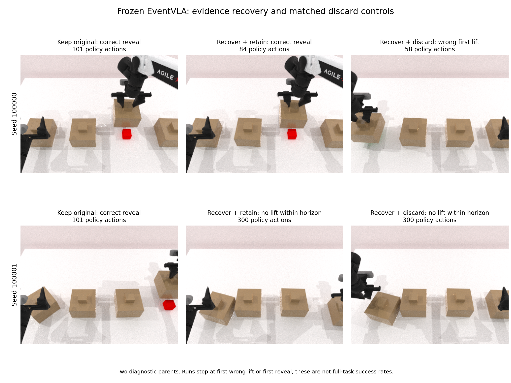
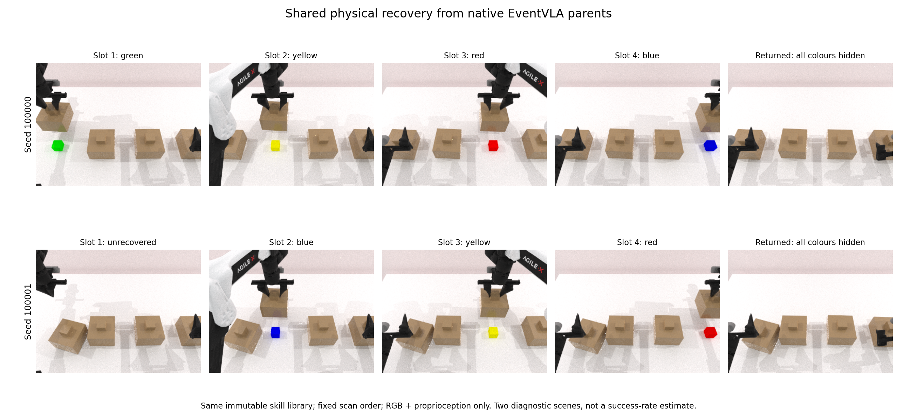

# 2026-10-16：共享回看与冻结 EventVLA 恢复闭环

已完成六条主对照和一条失败定位对照，自己的实验进程已结束并清理。真实 EventVLA 的“删除旧事件—物理回看—写入新事件—再次提交”链路在一个场景成功；另一个场景暴露出回看后的续接限制。当前仍是四步中的第二步，正式逐证据 K/R 数据与正式评分器训练尚未开始。

## 主结果与严格边界

两个选定的开发父状态，不估计普遍成功率。保留原事件正确揭盖 2/2；整组删除后回看正确揭盖 1/2；执行相同回看后删除新事件为 0/2。停止条件为首次错误抬盖、首次原生揭盖、原生失败或 300 策略动作。因此不能把表中的失败描述为完整任务必然失败，不能把数字当未经修改的原生 benchmark 分数。

| 种子 | 条件 | 实际结果 | 策略动作 | 恢复物理 tick | 策略物理 tick | 模型请求 |
|---|---|---|---:|---:|---:|---:|
| 100000 | keep | 正确揭开红色目标 | 101 | 0 | 8114 | 3 |
| 100000 | recover | 正确揭开红色目标 | 84 | 17689 | 6408 | 2 |
| 100000 | recover_discard | 首次抬错盖子（尚未实际揭开） | 58 | 17689 | 4832 | 2 |
| 100001 | keep | 正确揭开红色目标 | 101 | 0 | 7944 | 3 |
| 100001 | recover | 300 动作内无有效抬盖 | 300 | 24891 | 21470 | 6 |
| 100001 | recover_discard | 300 动作内无有效抬盖 | 300 | 24891 | 20021 | 6 |

seed 100000 的 recover 与 recover_discard 在提交时的物理状态、当前 RGB、近期历史、12 张时序锚点、时间与随机种子完全相同。前者保留四条新事件并正确揭盖；后者无新事件，首次抬起错误的第一个盖子。这支持“新取回的事件输入影响了该场景的目标选择”，不证明学习评分器优于规则。

seed 100001 的两条恢复分支均在 300 动作内没有任何有效抬盖。它们不能计为“首次选错”。正确的新红色证据确实已进入 recover 的实际模型请求，但这仍不足以完成操作。



## 共享控制器实际覆盖率

统一使用校准种子 424242 的不可变共享技能库、固定槽位扫描、每槽最多三次 RGB 反馈尝试与 30,000 tick 总预算。没有测试时专家规划或真值驱动动作。原生前缀重建的物理和三视角观察均逐字节匹配。

| 种子 | 成功取回 | 未取回 | 每槽尝试次数 | 扫描／返回成本 | 闭盖等待后总成本 |
|---|---|---|---|---:|---:|
| 100000 | 4/4 | 无 | 1,1,1,1 | 15,129 | 17,689 |
| 100001 | 3/4 | 槽位 0 的绿色证据 | 3,1,1,1 | 22,331 | 24,891 |

两者均通过物理闭合与提交状态检查，完整证据恢复只有 1/2。seed 100001 的第一盖在原生父状态已有偏转，固定技能连续抓空；失败尝试保留并收费。开发期先尝试三次重试，发现仍失败后，显式修订为保留未恢复项、继续其余槽位。旧的 gate_passed 仍表示全部恢复，motion_gate_passed 单独表示物理／提交有效性，没有把部分恢复包装成完整成功。

闭盖等待固定为 max(32, temporal_history_capacity+1)×80 tick，本次均为 2,560 tick。每种恢复条件的 32 次等待期采样中，三个视角的积木分割可见像素均为零，完整近期 RGB 队列也无可读颜色；评价分割信息不进入动作或策略输入。



## 失败定位补充对照

主对照显示第二场景无有效抬盖后，预先固定一个独立的 recover_original 探索性条件：从分支开始就保留原四条事件，执行同样的扫描、重试、返回、等待；新采集帧不写入事件缓存，不是删除后从存档补回。

结果：**300 动作内无有效抬盖**，300 个策略动作，24891 个恢复 tick，25656 个策略 tick，6 次模型请求。补充对照即使保留全部原记忆也未正确揭盖。仅补回原记忆不足以解决第二场景，不能把原恢复分支的失败直接归因于少一条事件；下一步需隔离回看导致的物理扰动与模型时间／续接适配。该结果尚未唯一确定根因。

补充对照与主 recover 的提交物理、当前图像、近期历史、锚点、时间、恢复成本和随机种子均匹配；输入事件及元数据与原 keep 的四条记忆相同。该探索性单场景结果不混入主六条或正式方法比较。

## 验证与运行稳定性

- 29 项相关单元测试通过，覆盖 recovery/commit 不可逆切换、失败状态保留、预算、关节桥接、有限重试及缓存干预。
- 主对照 50 项配对／输入审计全部通过，22 次模型请求无被删除证据哈希泄漏，专家接口调用为 0。两条 keep 的全部实际请求图像、动作及最终物理哈希与此前基线精确相同。
- 补充对照 13 项配对／输入检查全部通过。
- 两个父状态的快速前缀验证分别耗时 33.69 / 34.17 秒（含环境初始化）。它只跳过固定动作回放中未使用的 RGB 读取；真正模型闭环仍正常取图。父状态精确匹配及两条 keep 的全轨迹复现共同验证了本次使用范围。
- 最终回看验收、主对照及补充对照共 146 次资源采样，告警 0 次；GPU 1 最高 80℃、显存最高 15712 MiB，CPU 最高 62℃，可用主存最低 212.92 GiB。

串行相机读回在本轮未再次出现昨日的停滞；这不能证明已定位或修复此前整机死机的根因。

## 四步进度与接续任务

1. 真实 EventVLA 基线链路已跑通，当前两个父状态的有效基线已再次精确复现。
2. 本轮补上了公开回看／提交协议、共享恢复控制与实际模型续接，并明确保留不完整恢复和无抬盖失败。三类正式配对任务、单条证据影响及恢复后稳定操作仍需验证。
3. 正式逐条 K/R 尚未采集。既有固定工位先导评分器是历史机制原型，本轮没有训练正式 EventVLA 评分器。
4. 尚未开展正式学习方法对强规则／完整存档比较。

下一轮先按补充对照结论校准第二场景续接，并将“整组删除＋扫描全部槽位”改为按单条证据的 K/D/R 配对：其余记忆保持一致、失败尝试收费、恢复状态单独计量。然后在未用于本轮调试的新种子上验证，满足数据契约后再扩大采集与训练。禁止把本报告的整组诊断结果当逐条训练标签。

## 资产与复现

远程根目录：`/home/user/workspace/HDD_8T/eventvla_recoverability_phase1_20261014`（解析到 `/media/user/HDD_8T/eventvla_recoverability_phase1_20261014`）。本机工作区的 `outputs/eventvla_recoverability_phase1_20261014` 保存源码、报告和本轮全部运行证据副本。

- 最终共享控制验收：`20261016T015115Z_native_recovery_gate`。
- 六条主对照：`20261016T020148Z_native_recovery_vla`。
- 独立原记忆保留对照：`20261016T021616Z_native_recovery_original_probe`。
- 开发失败记录：`20261016T013420Z_native_recovery_gate`、`20261016T014442Z_native_recovery_gate`；没有丢弃抓空记录。
- 报告：`reports/native_recovery_validation.json`、`reports/native_recovery_original_probe_validation.json`、`reports/native_recovery_resource_summary.json`。
- 协议：`docs/native_recovery_protocol.md`。每次运行的源码版本及哈希保存在对应 `runs/*/source/` 与 `status.json`。

```bash
cd /home/user/workspace/HDD_8T/eventvla_recoverability_phase1_20261014
nvidia-smi
envs/tools/bin/python scripts/run_native_recovery_gate.py --gpu 1
envs/tools/bin/python scripts/run_native_recovery_vla.py --gpu 1
envs/tools/bin/python scripts/run_native_recovery_vla.py --gpu 1 --seeds 100001 --original-memory-probe
envs/tools/bin/python scripts/analyze_native_recovery.py
envs/tools/bin/python scripts/analyze_recovery_original_probe.py
```

以上实验均须在 GPU 空闲时串行执行。快速前缀只在已有双父状态等价性验证与源代码哈希匹配时启用。当前没有后台实验，也没有启动训练任务。
